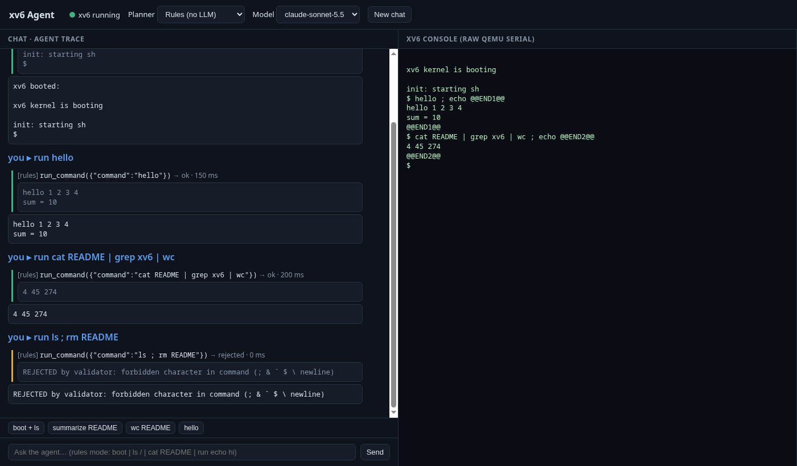
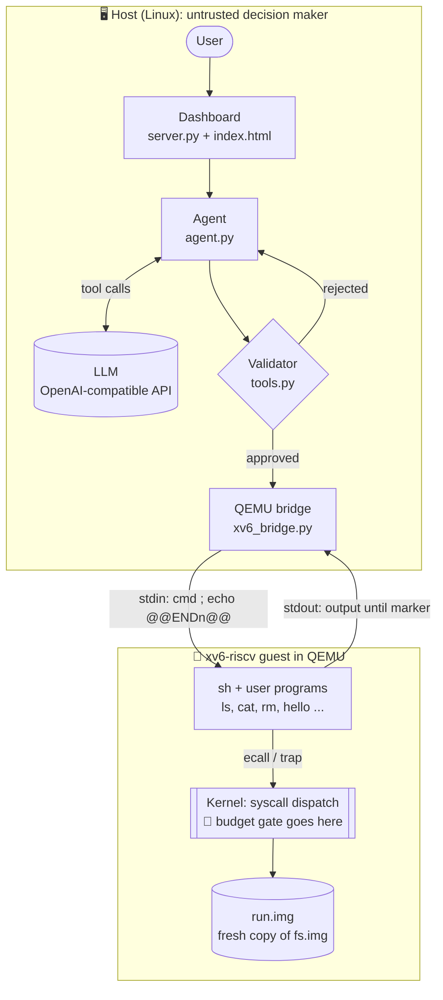
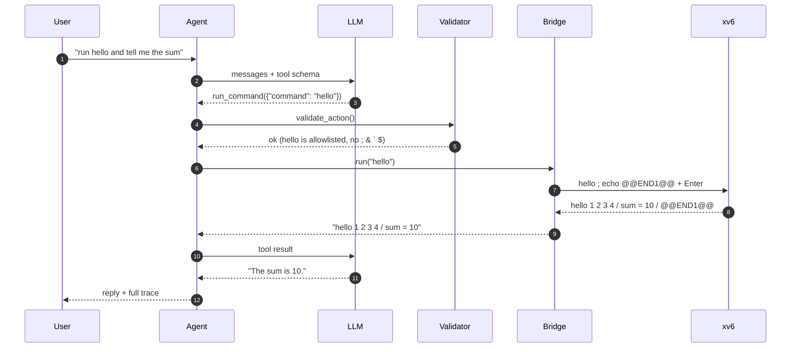
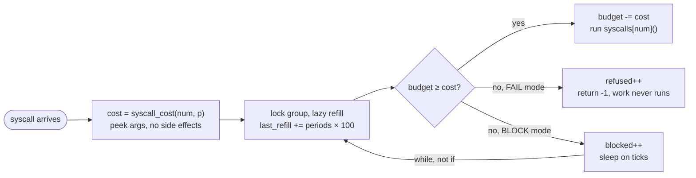

<div align="center">

# xv6 Irreversibility Budget

**Kernel-enforced limits on hard-to-undo actions, for AI agents that drive an OS.**

An agent can be talked into anything. The kernel can't.

[](https://github.com/mit-pdos/xv6-riscv)
[](https://www.qemu.org/)
[](agent/)
[](#)
[](#roadmap)

</div>

---

## The idea

AI agents call tools that delete files, send output to the outside world and run code. Some of these actions can't be undone. A prompt injection hidden in a file can tell an agent to do exactly that, and the user program that carries out the action has no way to tell a real request from an injected one.

This project adds an **irreversibility budget** to xv6. Each **process group** gets an allowance of hard-to-undo work. Every system call is **charged before it runs**. When the allowance is used up, the call either blocks until the budget refills or fails at once. The budget belongs to the whole group, so a refused process can't fork a child with a fresh allowance.

On top of the required design, we plan to make the cost follow what is actually lost:

- **Nested budgets.** A group can't escape its limit by calling `setgroup` or `setbudget` itself.
- **Leak audit.** `O_TRUNC`, in-place overwrite and link tricks also destroy data, so they get charged too.
- **Size-proportional cost.** Deleting 64 KB costs more than deleting an empty file.
- **Kernel trash.** A delete becomes reversible, so it costs less. The full price is paid only when the file is purged.

> **Pitch:** the kernel charges a group for what it *cannot undo*, and it can make actions undoable so they cost less.

The full design, with diagrams, is in **[docs/Q1_Irreversibility_Budget_Architecture.pdf](docs/Q1_Irreversibility_Budget_Architecture.pdf)**.

---

## What works today (stage 0)

<p align="center">
  
</p>

| | Feature | Status |
|---|---|---|
| 🖥️ | **QEMU bridge**: builds xv6, boots it, drives the serial console, returns clean per-command output | ✅ |
| 🧰 | **Validated tools**: `boot_xv6`, `list_files`, `read_file`, `run_command`, `status`, `shutdown_xv6` | ✅ |
| 🛡️ | **Validator**: rejects unknown tools, bad args, programs outside the allowlist, and `; & \` $` | ✅ |
| 🤖 | **LLM planner** over any OpenAI-compatible endpoint, using function calling | ✅ |
| 📏 | **Rule planner** (no LLM) for repeatable tests | ✅ |
| 💬 | **Dashboard**: chat, tool-call trace with verdicts and timings, live console | ✅ |
| ♻️ | **Fresh disk per boot**: the agent runs on a copy of `fs.img`, so demos can't damage the build | ✅ |
| 👋 | **`hello` system call**: the day-4 checkpoint, the first kernel change | ✅ |
| 💰 | Irreversibility budget in the kernel | 🚧 next |

### The gap this project closes

When asked to *"delete README"*, the LLM proposes `rm README`. The validator **lets it through**, because `rm` is a legitimate tool. Nothing below the agent limits how much it can destroy. That's what the kernel budget is for.

---

## Architecture



### One request, end to end



### Planned kernel design (stage 1+)



---

## Quick start

**Requirements:** `qemu-system-riscv64`, a RISC-V ELF toolchain (`riscv64-elf-gcc` or `riscv64-unknown-elf-gcc`), Python 3.10+.

```bash
git clone https://github.com/harshitsaini17/xv6-irreversibility-budget.git
cd xv6-irreversibility-budget

# Plain xv6, as usual
make qemu            # Ctrl-A then X to quit
$ hello              # -> hello 1 2 3 4 / sum = 10

# Agent + dashboard
cd agent
./run.sh             # creates a venv on first run, serves http://127.0.0.1:8765
```

### LLM configuration

The agent talks to any OpenAI-compatible `/v1/chat/completions` endpoint that supports tool calling.

| Variable | Default | Meaning |
|---|---|---|
| `LLM_BASE_URL` | `http://localhost:8000/v1` | API base URL |
| `LLM_API_KEY` | *(read from local gateway `.env`)* | API key, never committed |
| `AGENT_MODEL` | `claude-sonnet-5.5` | default model (`claude-haiku-5.5` and `claude-opus-5.5` are in the dashboard) |
| `CPUS` | `1` | QEMU harts (`3` to expose races) |

No LLM? Switch the dashboard's planner to **Rules**:

```
boot          ls /          cat README          run cat README | grep xv6 | wc          stop
```

> ⚠️ The dashboard has **no authentication** and binds to `127.0.0.1` only. Don't expose it.

---

## Repository layout

```
.
├── kernel/                 xv6 kernel (+ sys_hello in sysproc.c, SYS_hello = 23)
├── user/                   xv6 user programs (+ hello.c)
├── mkfs/                   file-system image builder
├── agent/
│   ├── xv6_bridge.py       QEMU lifecycle + serial command protocol
│   ├── tools.py            tool schema, validator, dispatcher
│   ├── agent.py            rule planner + LLM function-calling loop
│   ├── server.py           FastAPI backend for the dashboard
│   ├── static/index.html   dashboard UI
│   └── run.sh              one-command launcher
└── docs/
    ├── Q1_Irreversibility_Budget_Architecture.pdf
    └── img/
```

The history keeps every upstream MIT commit, so `git diff e93dabe` shows exactly the files we added or changed for the submission zip.

---

## Roadmap

- [x] **Stage 0**: QEMU bridge, validated tools, LLM agent, dashboard, `hello` system call
- [ ] **Stage 1**: groups table, `setgroup` / `setbudget`, charge-before-work gate, lazy refill, BLOCK / FAIL, `budgetstat`
- [ ] **Stage 2**: `creator_gid` in the on-disk inode (IPB 16 → 15), argument-dependent costs, required BLOCK vs FAIL graph
- [ ] **Stage 3**: nested budgets, leak audit, proportional cost, fair BLOCK queue
- [ ] **Stage 4**: kernel trash + `undelete`, agent prompt-injection demo with the damage capped by the kernel

---

## Acknowledgements

Built on [xv6-riscv](https://github.com/mit-pdos/xv6-riscv) by MIT PDOS (see [`LICENSE`](LICENSE) and the original [`README`](README)). Project brief from CSL3030 Operating Systems Lab, IIT Jodhpur.

<div align="center"><sub>Harshit Saini · B24CS1031 · IIT Jodhpur</sub></div>
